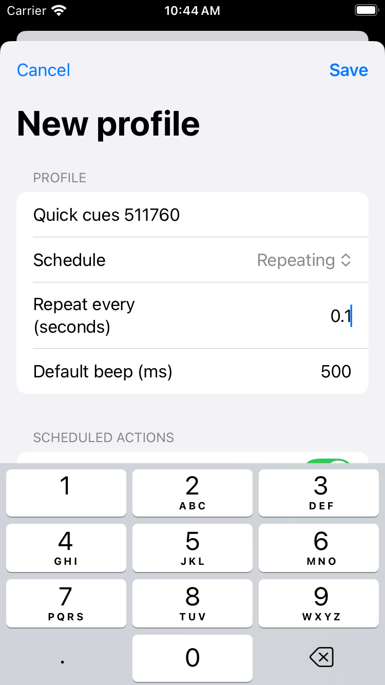
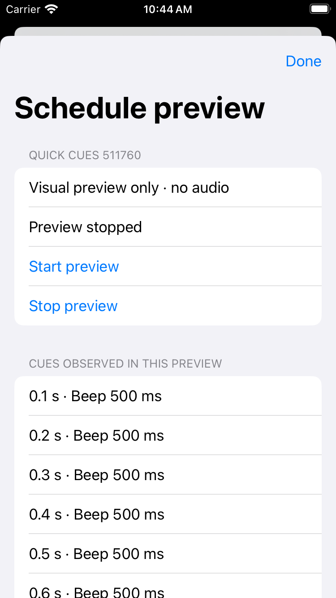
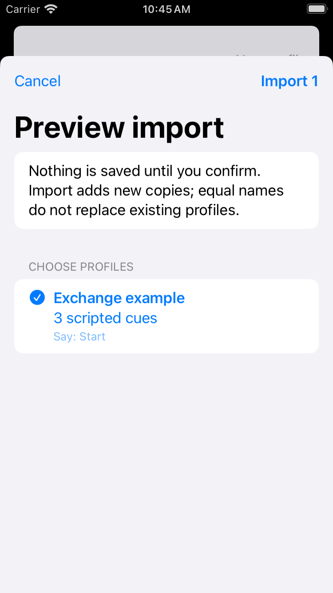
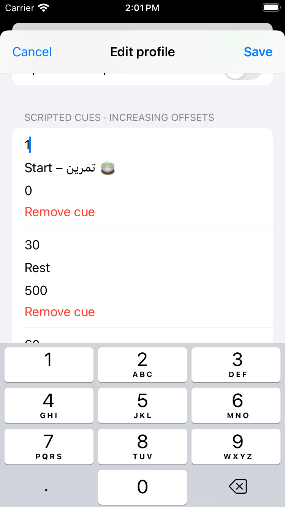
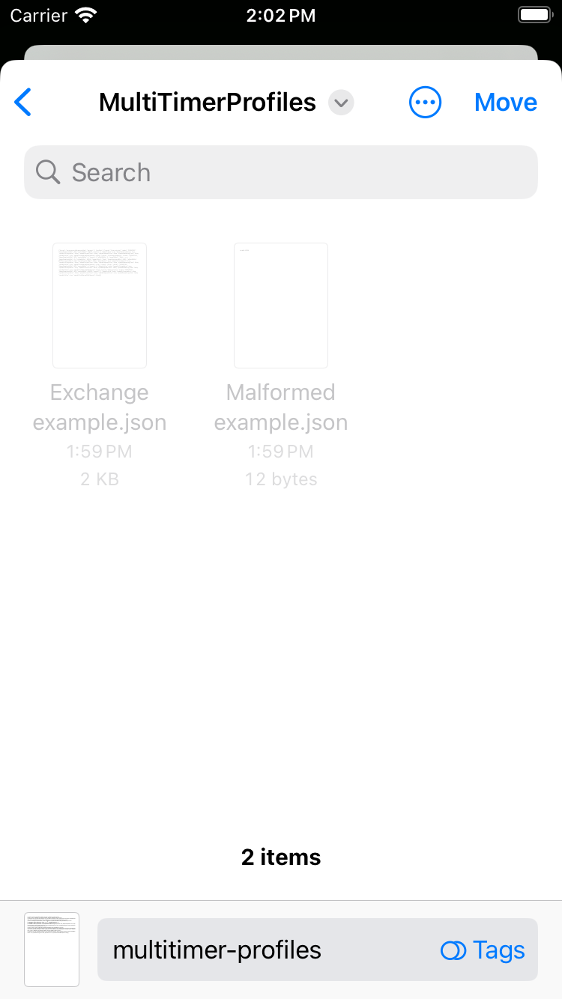
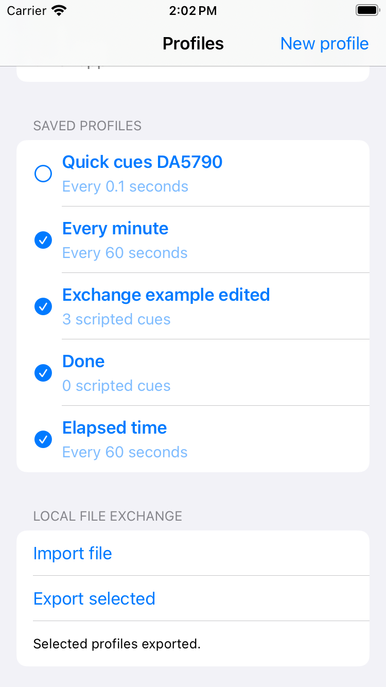

# Edit Android timer profiles with the SwiftUI companion

MultiTimer Profiles is a small native editor for reusable schedules. Create or
edit profiles, inspect a visual schedule preview, and exchange JSON files with
the Android timer app. The companion does not run background timers or play
audio; Android continues to own timing and playback.

For a sample to import, download the
[four-profile example](../../profiles/exchange-examples.json). It contains
repeating, scripted, completion-only and speech-only profiles, including Unicode
names/text. Importing it creates new copies only after confirmation.

## Create and preview

1. Open the companion and choose **New profile**.
2. Enter a name. Choose **Repeating** and an interval in seconds, or **Scripted**
   and increasing cue offsets in seconds.
3. Choose the scheduled and completion actions. Speech options and beep options
   remain independent; including the timer name in speech is opt-in.
4. Choose **Save**. An invalid field keeps the editor open; **Cancel** discards
   the draft. Reopen a saved row to edit that profile.
5. Choose **Preview schedule**, then **Start preview**. **Stop preview**, leaving
   the screen or making the app inactive stops the visual preview. It shows up
   to 60 seconds and 50 cues, and plays no sound.

## Android → companion → Android

1. In Android, open **Reusable profiles**, check the profiles to share, then
   choose **Export selected** and a JSON file destination.
2. Copy that file using your ordinary file-transfer method. No server or
   account is required by either app.
3. In the companion, choose **Import file**, then select the JSON document in
   Files. Review the selected profiles and choose **Import**. **Cancel** saves
   nothing. Import adds new copies; equal names never replace existing rows.
4. Open an imported row, edit its name/interval/cues/actions, then **Save**.
5. Check the circles beside the profiles to export. Choose **Export selected**,
   select a folder and confirm the system action (**Move**, **Export** or
   **Save**, depending on the OS).
6. Copy the exported file to Android. Open **Reusable profiles → Import file**,
   inspect the preview and confirm **Import selected**.
7. Attach the new reusable copy to the desired timer when ready. Importing a
   profile does not change an existing timer's attachment or progress.

The [Android guide and recording](profile-sharing.md) demonstrate its picker
workflow. The images here are unmodified iOS 18.5 simulator captures: editor,
preview and single-profile import from 9a40490; scripted edit and four-profile
export from 1edbaf4. They show actual rendered screens, not audible timing measurements.

## Short demonstration

Watch the [54-second actual companion demonstration](images/companion-demo.mp4).
It shows creation, visual preview, native picker cancellation, import/confirmation,
scripted editing, selected export and the final completion message.

This is an iOS 18.5 simulator recording from source 7413a0f, captured during
passing run 40899895909. Playback is 3× speed, trailing test teardown is trimmed
and the final confirmation frame is held for two seconds. It has no audio.
The [Android recording](images/profile-exchange-demo.mp4) covers that app's real
physical-picker flow; [task 014](../tasks/profile-sharing/014-cross-platform-check.md)
records the passing complete two-app file exchange.

## Build, tests and boundaries

Use the [companion build instructions](../../ios/MultiTimerProfiles/README.md)
with Xcode on macOS, or run the checked-in standard Mac workflow. Simulator
testing needs no signing identity, physical Apple device or paid enrollment.
An unsigned simulator build is not a store release or an installable phone build.

The [shared format](../profile-format.md) carries schedule/audio settings,
not local profile IDs, clocks or diagnostic history. Draft validation happens
before saving. Malformed/oversized imports and cancelled previews preserve the
saved library. If the saved library is unreadable, the app reports it and
disables writes rather than replacing it with an empty library.

The [combined verification task](../tasks/profile-sharing/014-cross-platform-check.md)
records actual two-app acceptance. The manual **Cross-platform file exchange**
workflow sends real Android output through the companion's import/editor/export
and back to Android. It compares all fields and checks fresh import identities
and preservation of an attached running clock. Android's instrumentation stubs
the external picker result; Apple's simulator picker is driven directly.
Codec/model tests alone do not establish this complete workflow. HTTP/cache
remains a deferred extension.
