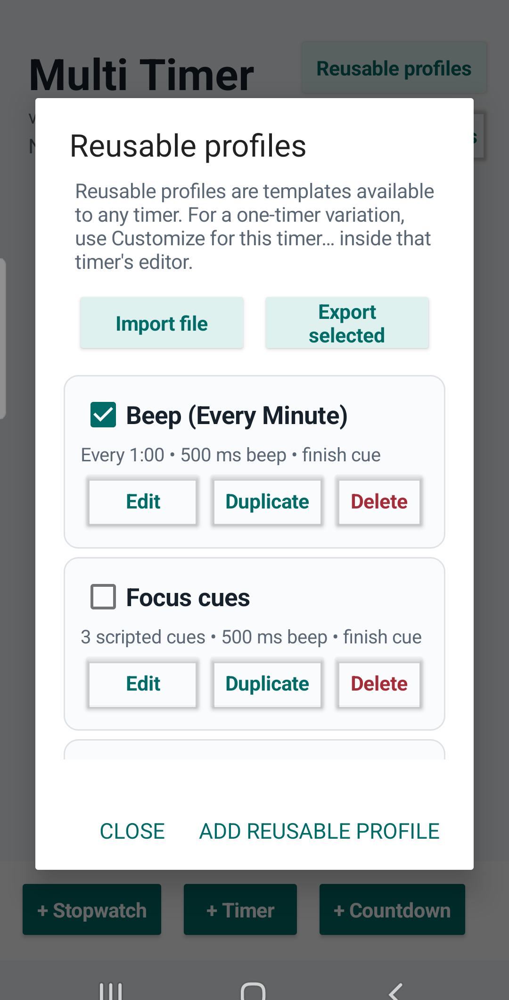
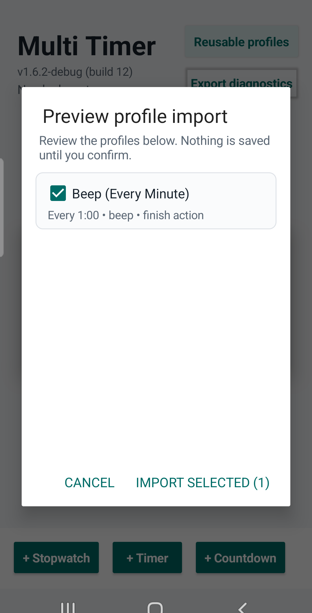
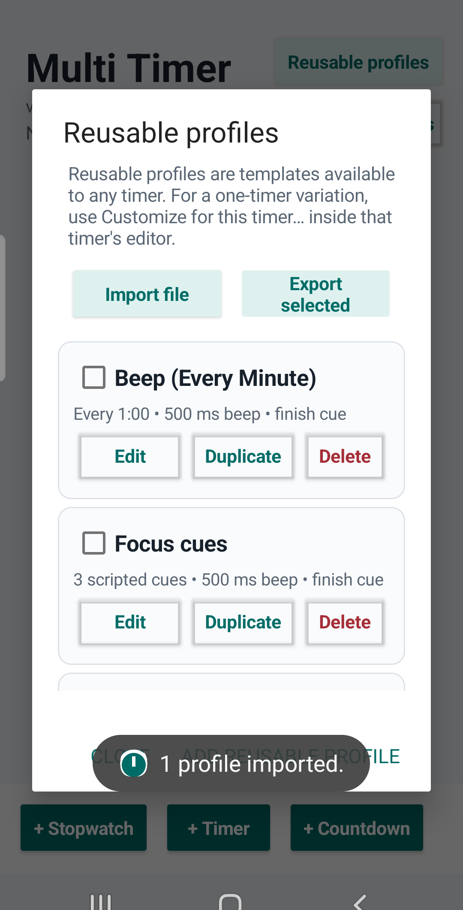

# Share reusable profiles

MultiTimer can export selected reusable profiles to a JSON file and import
that file later. The file contains profile settings, not clocks or timer
history. Import displays a preview and changes saved profiles only after you
confirm.

To edit the file in the native SwiftUI companion and bring it back to Android,
follow the [companion exchange guide](companion.md).

## Export

1. Open **Reusable profiles**.
2. Select each profile you want to share.
3. Tap **Export selected**.
4. Choose a folder and filename in Android's save dialog.

Only checked reusable profiles are exported. Timer-specific private copies and
clock state are not included.

## Import

1. Open **Reusable profiles** and tap **Import file**.
2. Choose the JSON profile file in Android's file picker.
3. Review the names and schedule/action summary in the preview.
4. Uncheck any profile you do not want, then tap **Import selected**.

Nothing is saved before the final confirmation. Cancelling the picker or the
preview leaves saved profiles unchanged. Import adds new local copies; it does
not update a profile with the same name. Importing the same file again can
therefore create another copy. Existing clocks and their selected profiles are
not replaced.

After confirmation, the app reports how many profiles were imported.

## Short demonstration

Watch the [30-second profile-sharing demonstration](images/profile-exchange-demo.mp4)
to see selecting a reusable profile, exporting it, opening the saved file,
reviewing the preview, and confirming the import.

The screenshots and recording are direct captures of MultiTimer 1.6.2-debug
(build 12) on Android 12. The status bar was cropped from the published media.
